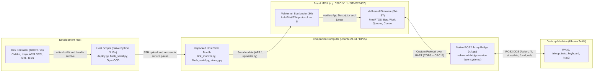
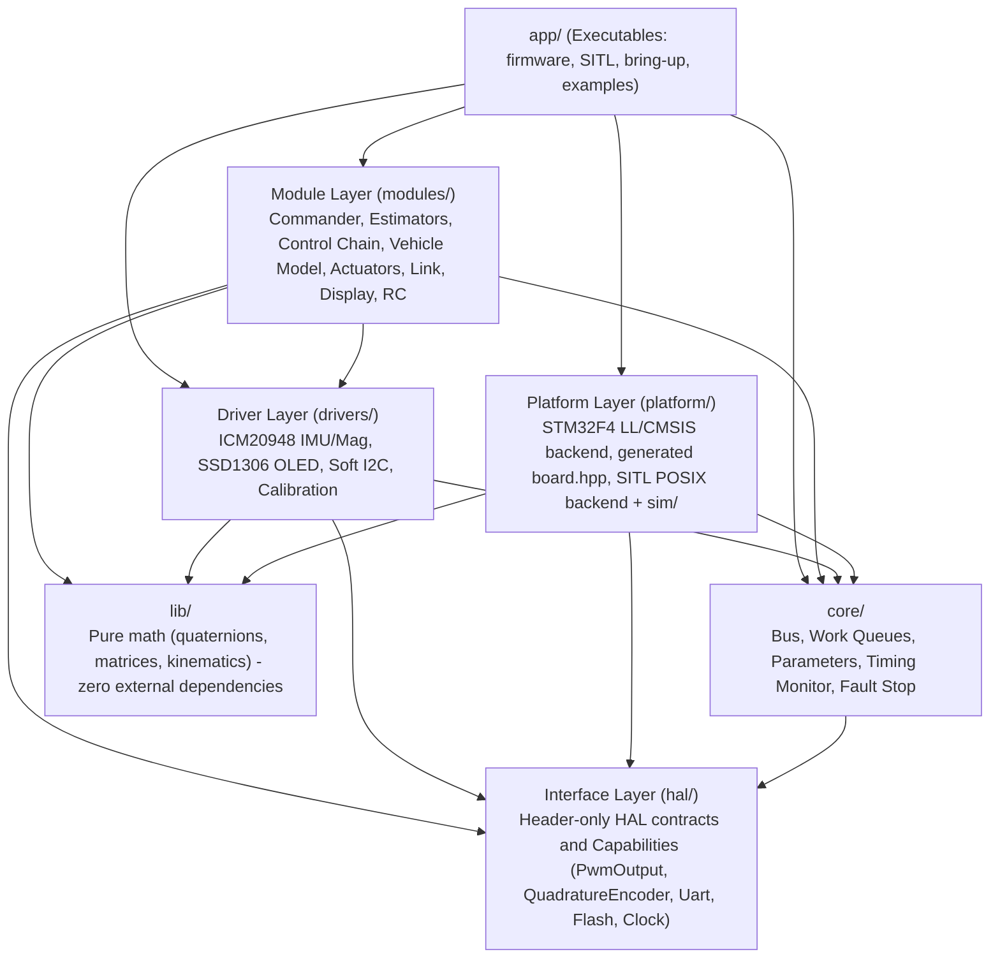
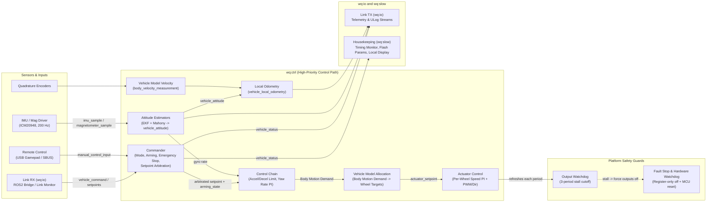

# Architecture

This guide explains how Vehkernel is organized, how data flows through the firmware at runtime, and why responsibilities are split across the MCU, companion computer, development host, and desktop machine. Each section links to the Architecture Decision Records (`docs/adr/`) that capture the underlying trade-offs.

## MCU responsibility boundary and deployment topology

Vehkernel enforces a hard boundary between real-time vehicle control and high-level autonomy ([ADR-0001](../adr/0001-mcu-responsibility-boundary.md)):

- **The MCU owns real-time estimation, low-level control, and safety.** It runs IMU and magnetometer acquisition, attitude estimation, local odometry, setpoint arbitration, the control chain, actuator control, emergency stop, output watchdog, and fault stop. A vehicle remains safe and drivable in **standalone** operation via Remote Control without a companion computer.
- **ROS2 on the companion computer owns global localization, mapping, and navigation.** Global pose estimation (SLAM, VIO, GNSS fusion), path planning (Nav2), and perception live above the Link ([ADR-0002](../adr/0002-bus-backbone-and-pluggable-links.md), [ADR-0003](../adr/0003-vehicle-level-ros2-api.md)). The MCU never depends on ROS2 for stability or safety.

Across machines, Vehkernel separates build reproducibility, hardware access, and ROS2 runtime into four distinct environments ([ADR-0016](../adr/0016-dependency-policy.md), [ADR-0026](../adr/0026-host-tools-bundle.md), [ADR-0027](../adr/0027-ros2-bridge.md), [ADR-0028](../adr/0028-host-environment-setup.md)):

### Rationale for each deployment boundary

- **Why firmware builds stay in the development container ([ADR-0016](../adr/0016-dependency-policy.md)):** Every build-affecting tool—ARM GCC, CMake, Ninja, `clang-tidy`, `kconfiglib`, and the Python generators—is pinned in `.devcontainer/Dockerfile` and published as a multi-architecture image (`ghcr.io/chimu0510/vehkernel-dev:latest` for `linux/amd64` and `linux/arm64`). Contributors and CI build byte-for-byte against the same toolchain without polluting the host OS.
- **Why host tools travel in a Host Tools Bundle ([ADR-0026](../adr/0026-host-tools-bundle.md)):** Python host tools (`link_monitor.py`, `flash_serial.py`, `mag_cal.py`, `accel_check.py`) need build-generated schema decoders (`vkmsg.py`), parameter metadata (`params.json`), board layout (`board.json`), and firmware images (`vehkernel.apj`). Packaging those outputs into an architecture-independent archive (`vehkernel-<preset>-<commit>.tar.gz`) lets a companion computer flash, monitor, log, and calibrate without running Docker or CMake.
- **Why the ROS2 Bridge runs natively ([ADR-0027](../adr/0027-ros2-bridge.md)):** On Ubuntu 24.04 companion computers (such as a Raspberry Pi 5), running the `rclcpp` Bridge natively against apt-installed ROS2 Jazzy avoids containerizing serial device permissions, DDS multicast discovery, and user colcon workspaces alongside other vehicle nodes.
- **Why the Bridge uses a user `systemd` service ([ADR-0028](../adr/0028-host-environment-setup.md)):** Installing `vehkernel-bridge.service` under `~/.config/systemd/user/` with `loginctl enable-linger` starts the Bridge at boot while keeping it owned by the unprivileged user. `tools/flash/deploy.py` can therefore pause the Bridge before serial flashing and restart it afterwards over non-interactive SSH without `sudo` or `/etc/sudoers.d` rules.

## Firmware layer architecture

Every first-party C++ library in the firmware belongs to one of six architectural layers enforced at CMake configure time by [`cmake/VehkernelLayers.cmake`](../../cmake/VehkernelLayers.cmake) ([ADR-0009](../adr/0009-layered-hal.md)). Any disallowed link dependency fails configuration immediately rather than drifting during code review.

### Enforced dependency matrix

| Layer (`VK_LAYER`) | Directory | Allowed dependencies (`vk_target_link_libraries`) | Role |
|---|---|---|---|
| `module` | `modules/` | `module`, `driver`, `interface`, `core`, `lib` | Domain logic: commander, estimators, control chain, vehicle models, actuator control, Links, remote control, local display |
| `driver` | `drivers/` | `driver`, `interface`, `core`, `lib` | Board and external device drivers (for example ICM20948, SSD1306, software I2C), talking only to HAL interfaces |
| `interface` | `hal/` | `interface` | Pure C++ contracts and platform **Capabilities** (`PwmOutput`, `QuadratureEncoder`, `I2cBus`, `Flash`, `OutputWatchdog`) |
| `platform` | `platform/` | `platform`, `interface`, `core`, `lib` | MCU-specific implementations (`platform/stm32f4/` + generated `vk_board`) or the host FreeRTOS POSIX backend (`platform/sitl/` + `sim/`) |
| `core` | `core/` | `core`, `interface` | Bus, work queues, parameter table and Flash storage, timing monitor, fault and reset handling, generated `vk_msg` and `vk_params` |
| `lib` | `lib/` | `lib` | Hardware- and RTOS-independent math and algorithms |

`app/` executables (`firmware_main.cpp`, `sitl_main.cpp`, bring-up, and board examples) sit above the library graph to wire concrete platform objects, drivers, and modules together at startup.

### C++20 embedded subset rules

Firmware targets compile with C++20 (`-std=c++20`) and strict warnings (`-Wall -Wextra -Wshadow -Werror`, plus `clang-tidy` on `sitl`, `test`, and `fuzz` presets) under the embedded subset of [ADR-0007](../adr/0007-cpp20-subset.md):

- **No exceptions, no RTTI, no thread-safe statics** (`-fno-exceptions -fno-rtti -fno-threadsafe-statics` on STM32 targets).
- **No dynamic allocation after initialization**, and no heap-allocating STL containers (`std::vector`, `std::string`, `std::map`). Topics, work queues, and module state are statically allocated at compile time.
- **C interop at the platform edge only:** FreeRTOS, CMSIS, ST LL, and TinyUSB remain C libraries wrapped behind `extern "C"` inside `platform/` or dedicated driver glue.

> [!NOTE]
> Because `platform/sitl/` implements the exact same `hal/` contracts on the FreeRTOS POSIX port with simulated devices in `sim/`, the same module, driver, and core C++ code runs unmodified in SITL and on STM32 hardware ([ADR-0018](../adr/0018-test-layers-and-sitl.md)).

## Real-time execution and runtime dataflow

Vehkernel runs on **FreeRTOS** ([ADR-0004](../adr/0004-freertos.md)), organized into three rate-tiered **Work Queues** rather than one task per module ([ADR-0008](../adr/0008-bus-and-work-queues.md)):

| Work Queue | Priority tier | Typical work items | Timing rules |
|---|---|---|---|
| `wq:ctrl` | Highest (control path) | IMU/mag driver, EKF and Mahony attitude estimators, commander, remote control, wheel velocity measurement, control chain, local odometry, actuator control | Deterministic periodic or IMU-event-driven chain (200 Hz base rate on C50C V1.1); never blocks on slow I/O or Flash erase |
| `wq:io` | Medium (communication) | Serial/UDP/pty Link work items (`link0`, `link1`) | Encodes and decodes Custom Protocol frames over DMA-backed UART or host sockets; handles handshake, time sync, parameters, and topic streams |
| `wq:slow` | Lowest (housekeeping) | Timing monitor, parameter Flash writer (`param_storage`), local display (`local_display`), local menu and user key | Bounded work per slice (for example capped Flash words per run and at most four OLED pages per run) so `wq:ctrl` and `wq:io` are never delayed |

Work items on different queues never call into each other directly—they communicate exclusively through typed, statically allocated topics on the **Bus** (`core/include/vk/core/bus.hpp`). ISRs never publish directly to the Bus; they notify a driver work item. Every Bus message carries a 64-bit monotonic microsecond `timestamp` as its first field ([ADR-0006](../adr/0006-schema-and-wire-encoding.md), [ADR-0008](../adr/0008-bus-and-work-queues.md)).

### Control chain and estimation design

- **Dual attitude estimators ([ADR-0014](../adr/0014-estimation-architecture.md)):** Both the error-state EKF and the Mahony complementary filter run on `wq:ctrl` immediately after `imu_sample` is published. The **Primary Estimator** (selected by `EST_PRIMARY`, default `EKF`) publishes `vehicle_attitude` for the control chain and local odometry; the secondary publishes `estimator_attitude` for live comparison and offline replay (`tools/log/replay.py`).
- **One shared control chain ([ADR-0013](../adr/0013-control-chain-and-vehicle-models.md)):** Every frame shares the same velocity slew limiting (`VEL_ACC_MAX`, `VEL_DEC_MAX`), gyro-closed yaw rate PI (`RATE_YAW_P`, `RATE_YAW_I`, `RATE_YAW_FF`), and per-wheel actuator speed PI (`MOT_OUT_MAX`, `MOT_SLEWRATE`). Frame-specific kinematics live exclusively inside the **Vehicle Model** (`modules/vehicle_model/`).
- **Setpoint arbitration ([ADR-0005](../adr/0005-setpoint-arbitration.md)):** The vehicle boots disarmed in `STANDBY`. The active **Mode** (`TEST`, `MANUAL`, or `COMPANION`) selects a single **Source in Control**. A Link can change mode only while disarmed, whereas the Remote Control can always take over in `MANUAL` (even while armed) to guarantee operator authority.

## Flash layout and safety invariants

On single-bank MCUs such as the STM32F407, Flash writes stall instruction fetches briefly (~16 µs per 32-bit word), whereas erasing a sector stalls the entire core (including ISRs and `wq:ctrl`) for hundreds of milliseconds up to 2 seconds. Vehkernel partitions internal Flash and constrains write operations accordingly ([ADR-0020](../adr/0020-internal-flash-layout-and-write-policy.md), [ADR-0023](../adr/0023-bootloader.md)):

| Region | C50C V1.1 Sectors | Address & Size | Contents and update policy |
|---|---|---|---|
| `BOOT` | S0 | `0x08000000` (16 KB) | Vehkernel Bootloader (ArduPilot/PX4 protocol rev 5). Written once via `new-board` or SWD; untouched by `update`. |
| `PARAMS` | S1–S2 | `0x08004000` (32 KB = 2 × 16 KB) | Append-only parameter entries keyed by 32-bit FNV-1a name hash with CRC-16, alternating between two sectors. Survives firmware updates. |
| `EVENTLOG` | S3 | `0x0800C000` (16 KB) | Event Log written from RAM ring buffer when a fault or event occurs. Survives firmware updates; erased only while disarmed after readout or explicit clear. |
| `FIRMWARE` | S4–S7 | `0x08010000` (448 KB) | Application image (`VTOR` at S4) with embedded ArduPilot **App Descriptor** (board ID, size, CRCs, version, git hash). Erased and rewritten by `update`. |

> [!WARNING]
> **Write-while-armed, never-erase-while-armed invariant (ADR-0020):** On single-bank Flash, the firmware erases the spare parameter sector at boot before arming is allowed. While armed, `param_storage` on `wq:slow` appends word-by-word in bounded batches and may compact into the pre-erased spare sector, but **never erases a sector until the vehicle disarms**. If both sectors fill while armed, changes remain in RAM (`unsaved`) until disarm.

### Core safety invariants

1. **Boot verification ([ADR-0010](../adr/0010-board-revision-policy.md)):** Before arming is allowed, the firmware confirms the board revision-ID pins match the compiled board definition and the onboard IMU responds. Failure keeps actuators permanently disabled.
2. **Emergency Stop ([ADR-0005](../adr/0005-setpoint-arbitration.md)):** Any connected Link or the Remote Control can trigger Emergency Stop, forcing all actuator outputs off immediately regardless of mode; holding it for 5 s disarms the vehicle.
3. **Output Watchdog:** If actuator control stalls for three control periods without refreshing the platform watchdog, the Output Watchdog forces all PWM and direction lines off.
4. **Fault Stop and Hardware Watchdog:** On a CPU fault, failed `configASSERT`, or stack overflow, Fault Stop disables every actuator output using direct register writes only (no RTOS calls), records the fault, and halts until the MCU Hardware Watchdog resets the board. After an unexpected reset (`FAULT` or `WATCHDOG`), arming is refused until the next deliberate reset (`reboot`, reset pin, or power cycle).
5. **Local Menu lockout ([ADR-0022](../adr/0022-local-display-and-local-menu.md)):** The Local Display never feeds the control chain, and the Local Menu edits only whitelisted `menu = true` parameters while disarmed. Arming is refused while the menu is open.

## Further reading

- [ADR index](../adr/README.md) — full list of architecture decisions (`ADR-0001` through `ADR-0028`).
- [Configuration and code generation](configuration-and-codegen.md) — how boards, Kconfig, parameters, and schemas are generated and extended.
- [First hardware deployment](first-deployment.md) — end-to-end setup from fresh hardware to ROS2.
- [Testing](testing.md) — six-layer verification model (`L0` through `L5`) and SITL.
