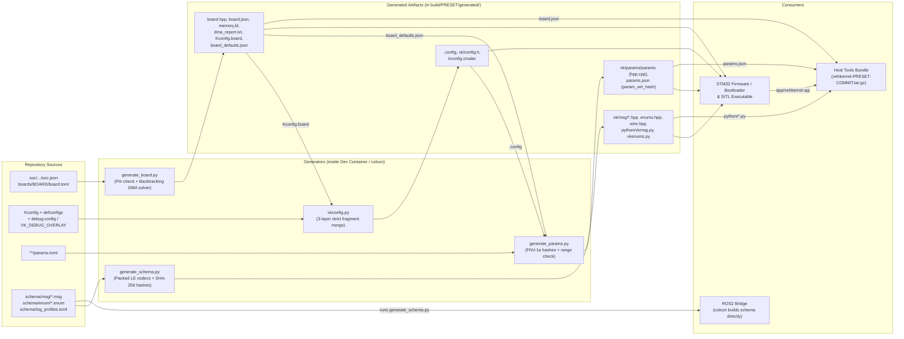

# Configuration and code generation

Vehkernel separates hardware facts, build-time feature selection, runtime tuning, and wire contracts into four distinct configuration layers. Each layer has a single source of truth checked by Python generators at configure or build time, so mismatches between firmware, SITL, host tools, and the ROS2 Bridge fail the build instead of surfacing on hardware.

## The four-layer configuration model

Use the table below to decide where a new setting belongs before editing code:

| Layer | Source of truth | Tool / Generator | When resolved | What belongs here |
|---|---|---|---|---|
| **1. Hardware facts** | `soc/<vendor>/<family>/<soc>/soc.json` + `boards/<board>/board.toml` | `tools/generators/generate_board.py` (`vkboard`) | CMake configure time | Pin roles and AFs, DMA requests, clocks, Flash regions, onboard devices and Mounting Rotations, revision-ID pins, board ID, bootloader ports, hardware-specific defaults ([ADR-0011](../adr/0011-toml-board-definition-toolchain.md)) |
| **2. Build features** | Root `Kconfig` + 3-layer fragments (`soc` or `sitl` defconfig → `board` defconfig → debug overlay) | `tools/kconfig/vkconfig.py` (`kconfiglib`) | CMake configure time | Which drivers, estimators, vehicle models, Link transports, local display, or test images are compiled into the binary ([ADR-0017](../adr/0017-kconfig-build-configuration.md)) |
| **3. Runtime tuning** | Co-located `params.toml` next to each module, driver, or platform | `tools/generators/generate_params.py` (`vkparams`) | CMake build time (after Kconfig) | Values that vary by vehicle, wiring, or user tuning (`WHL_*`, `EKF_*`, `MOT_*`, `SENS_BOARD_ROT`, `SERIALn_BAUD`), persisted in 2-sector Flash ([ADR-0012](../adr/0012-parameter-system.md)) |
| **4. Wire contracts** | `schema/msg/*.msg`, `schema/enum/*.enum`, `schema/log_profiles.toml` | `tools/generators/generate_schema.py` (`vkschema`) | CMake build time (firmware, SITL, and ROS2 Bridge) | Bus topic types, cross-wire enums, ULog profiles, packed little-endian C++/Python codecs, per-topic schema hashes ([ADR-0006](../adr/0006-schema-and-wire-encoding.md)) |

> [!TIP]
> **Rule of thumb (ADR-0012):** Hardware wiring facts stay in `board.toml` and only surface to runtime parameters as board defaults (`defaults = { ... }`). Safety invariants (such as the output watchdog period or unskippable arming checks) and datasheet register addresses remain compile-time constants—never parameters.

## Build-time code-generation pipeline

`CMakeLists.txt` runs the board and Kconfig generators during configuration (because CMake needs `BOARD_HAS_*` and `CONFIG_*` symbols to decide which targets to build), then runs the schema and parameter generators as build-time custom commands:



### Key generator guarantees

- **Board generator (`tools/generators/vkboard/`):** Validates every pin against `soc.json` (rejecting impossible AFs or pin collisions across every **Alt Config** combination), runs a deterministic **backtracking DMA solver** on fixed-stream MCUs such as the STM32F4 (writing `dma_report.txt`), verifies Flash regions match SoC sector boundaries (`memory.ld`), checks boot revision-ID pins and bootloader ports, and emits `Kconfig.board` hardware-presence symbols (`BOARD_HAS_*`).
- **Kconfig (`tools/kconfig/vkconfig.py`):** Merges fragments strictly in order: SoC defaults (`soc/.../defconfig`, or `platform/sitl/defconfig` for SITL) → board defaults (`boards/<board>/defconfig`) → local `build/<preset>/debug.config` (written by `--target menuconfig`, never committed) → any `VK_DEBUG_OVERLAY` fragments (such as `test/hardware/bringup.config`). Every assignment in a fragment must take effect; a silently dropped symbol due to an unmet dependency is a hard configure error.
- **Parameter generator (`tools/generators/vkparams/`):** Checks every `params.toml` in the repository—even those excluded by Kconfig—for unique module prefixes, valid names (at most 16 uppercase ASCII characters, MAVLink-compatible), and zero 32-bit FNV-1a hash collisions. Generates direct-access C++ structs (`vk/params/params.hpp`), Flash lookup tables, local menu ordering by `MENU_GROUPS` (`ATTITUDE`, `COMPASS`, `MANUAL`, `VEHICLE`, `BOARD`, `LINKS`, `DISPLAY`), and `params.json` with its 64-bit SHA-256 `param_set_hash`.
- **Schema generator (`tools/generators/vkschema/`):** Enforces `uint64 timestamp` as the first field of every `.msg` file, emits field-by-field packed little-endian `encode()`/`decode()` in C++ and Python (never `memcpy` of structs), computes a per-topic SHA-256 schema hash over wire layout (excluding enum values and `@enum` annotations so enums stay append-only), and flags control-critical topics marked `@required` (`vehicle_status`, `body_velocity_setpoint`, `vehicle_local_odometry`).

---

## How to extend Vehkernel

### 1. Adding a Bus topic or enum

1. **Define the enum (if needed):** Create `schema/enum/<name>.enum` with `@type <uint8|uint16|...>` and append-only `NAME = value` entries (plus optional `@short` for the 128×64 OLED). Existing enum numbers must never be renumbered or reused ([ADR-0006](../adr/0006-schema-and-wire-encoding.md)).
2. **Sync the checked-in Python enum copy:** The Link tools run without a build tree, so update `tools/link/vklink/enums.py` to match the generated `vkenums.py`. The schema generator tests fail if they diverge.
3. **Define the topic:** Create `schema/msg/<topic_name>.msg` starting with `uint64 timestamp` (microseconds). Add `@instances N` for multi-instance topics, `@queue N` if subscribers need queued history instead of latest-value semantics, `@enum <enum_name>` on enum-backed integer fields, and `@required` **only** if a mismatched hash must make the ROS2 Bridge refuse the Link connection.
4. **Expose over a Link (optional):** Register the topic and its rate limit in [`modules/link/src/default_topic_map.cpp`](../../modules/link/src/default_topic_map.cpp). Inbound topics are accepted by the MCU only if the Topic Map declares them.
5. **Add to a log profile (optional):** Add the topic and target rate to `schema/log_profiles.toml` if it should be recorded by `link_monitor.py record`.
6. **Verify cross-language wire compatibility:**
   - Add or extend wire test vectors in `test/unit/wire_vectors.cpp` and `test/unit/test_wire_cross_language.py` if introducing a new field pattern, and rebuild.
   - Run the generator, schema, and cross-language tests inside `vk`:
     ```bash
     vk cmake --build --preset test
     vk ctest --preset test -R 'schema|wire_cross_language' --output-on-failure
     ```
   - If the Bridge consumes the topic, rebuild `vehkernel_bridge` with `colcon build` so it regenerates its C++ codecs from the updated schema.

> [!NOTE]
> Changing a field type, order, or array size in an existing `.msg` changes that topic's **schema hash**. Peers built from an older schema will disable that topic (or refuse to connect if it is marked `@required`), while keeping unaffected topics running.

### 2. Adding a runtime parameter

1. **Locate or create `params.toml`:** Add the entry to the module or driver's co-located `params.toml` under `core/`, `drivers/`, `modules/`, or `platform/`. CMake discovers `params.toml` automatically via `cmake/VehkernelParams.cmake`.
2. **Respect naming and prefix rules:** Each file declares a unique `prefix` (and optional `kconfig = "<SYMBOL>"` guard without a `CONFIG_` prefix, for example `kconfig = "LOCAL_DISPLAY"`). Parameter names must start with `<PREFIX>_`, use uppercase ASCII, and be at most 16 characters long. Only `INT32` (used for integers, booleans, enums, and bitmasks) and `FLOAT` types are allowed.
3. **Set safety and Local Menu attributes:**
   - Add `reboot_required = true` for values read only at boot (such as geometry, estimator selection, or baud rates).
   - Add `locked_when_armed = true` for values that must not change while motors can spin (such as direction reversals or arming check masks).
   - To expose the parameter on the OLED Local Menu, set `menu = true`, `menu_group = "<GROUP>"` (one of `ATTITUDE`, `COMPASS`, `MANUAL`, `VEHICLE`, `BOARD`, `LINKS`, `DISPLAY`), optional `menu_order`, and `menu_step` (required for numeric parameters, omitted for enums; bitmasks cannot enter the menu). Safety-critical groups (such as `modules/commander/params.toml`) set top-level `menu = false` to block menu inclusion.
4. **Consume in C++:** Include `<vk/params/params.hpp>` and read fields directly from the generated RAM struct (no hash lookup on the hot path). Subscribe to `parameter_update` if a module needs to recompute derived state on runtime changes.
5. **Verify:** Build and run parameter generator, unit, and SITL tests:
   ```bash
   vk cmake --build --preset test
   vk ctest --preset test -R 'param|sitl_params|local_menu' --output-on-failure
   ```
   Adding or changing parameters updates `param_set_hash` in `params.json`. Because Flash storage keys entries by 32-bit FNV-1a name hash, existing user parameters on boards are preserved across updates.

### 3. Adding a module or driver

1. **Choose the right layer ([ADR-0009](../adr/0009-layered-hal.md)):**
   - If hardware access needs a new peripheral contract, add a minimal, header-only interface or **Capability** under `hal/include/vk/hal/`.
   - Place device drivers under `drivers/` (`vk_add_library(<name> LAYER driver ...)`) and domain logic under `modules/` (`vk_add_library(<name> LAYER module ...)`).
   - Link dependencies strictly with `vk_target_link_libraries()` so `cmake/VehkernelLayers.cmake` enforces layer boundaries.
2. **Add a Kconfig option:** Declare `config <OPTION>` in root `Kconfig` with `depends on` clauses (for example `BOARD_HAS_* || PLATFORM_SITL`), wire it into `modules/CMakeLists.txt` or `drivers/CMakeLists.txt`, and enable it in the relevant `boards/<board>/defconfig` and `platform/sitl/defconfig`.
3. **Assign a Work Queue and budget:** Attach the work item to `wq:ctrl` (hard real-time sensing/control), `wq:io` (Link/communication), or `wq:slow` (bounded housekeeping) in `app/firmware_main.cpp` and `app/sitl_main.cpp`. Keep `wq:ctrl` non-blocking and check execution time and jitter via `work_item_status` (Timing Monitor).
4. **Provide a SITL fake device (for drivers):** Add a simulated device in `sim/` (such as `sim/src/icm20948.cpp` or `sim/src/ssd1306.cpp`) wired through `platform/sitl/` so the new driver executes on the FreeRTOS POSIX port without hardware.
5. **Add L1 unit and L3 SITL tests:** Add unit tests under `test/unit/` (registered in `test/unit/CMakeLists.txt`) and, for end-to-end behavior, a SITL check script under `test/sitl/` (registered in `test/CMakeLists.txt`). Run the full suite with `clang-tidy` enabled:
   ```bash
   vk cmake --preset test
   vk cmake --build --preset test
   vk ctest --preset test --output-on-failure
   ```

### 4. Porting a new board

Vehkernel adds boards one at a time, only when physical hardware is on hand ([ADR-0010](../adr/0010-board-revision-policy.md)):

1. **Write the board ADR and bring-up spec:** Record the MCU family, Flash layout and write policy, bootloader choice and unique **Board ID** (from the shared ArduPilot/PX4 namespace, checked against `tools/generators/vkboard/board_types.txt`), and revision-ID verification in `docs/adr/NNNN-<board>.md` and `docs/specs/`.
2. **Ensure the SoC Database exists:** Check `soc/<vendor>/<family>/<soc>/soc.json` and `defconfig`. If adding a new SoC, convert its STM32Cube / `stm32-data` pin, AF, DMA, and Flash sector tables offline and commit the JSON together with its `source/` provenance under `soc/`.
3. **Create the Board Definition and defaults:** Add `boards/<board>/board.toml` (one pin per inline table, verified line by line against the schematic, declaring `serial`, `devices`, `actuators`, `revision`, `flash`, `clock`, `timing`, and `defaults`) and `boards/<board>/defconfig`.
4. **Add CMake presets:** Add `<board>` and `<board>-bringup` configure/build presets to [`CMakePresets.json`](../../CMakePresets.json) specifying `VK_PLATFORM`, `VK_BOARD`, and the ARM toolchain file.
5. **Configure the bootloader ([ADR-0023](../adr/0023-bootloader.md)):** Keep an existing ArduPilot/PX4 bootloader (`kind = "ARDUPILOT"` or `"PX4"`) if the board ships with one, or configure `kind = "VEHKERNEL"` with its bootloader ports and Flash `BOOT` region.
6. **Add platform support (if new MCU family):** Implement the `hal/` contracts under `platform/<family>/` without leaking vendor SDK headers into `hal/`, `drivers/`, or `modules/`.
7. **Run L4 bring-up and document the board:** Build and flash `<board>-bringup` with `tools/bringup/run_bringup.py` over SWD (never configuring actuator outputs), complete the motor-to-encoder bring-up case in `TEST` mode, add golden generator tests under `tools/generators/tests/boards/`, and create a board reference page under `docs/boards/<board>.md`.

## Further reading

- [Architecture](architecture.md) — system boundaries, layers, Work Queues, and Flash layout.
- [Building](building.md) — CMake presets, `menuconfig`, and the development container.
- [Testing](testing.md) — L0–L5 test suites, fuzzing, and faster local iteration.
