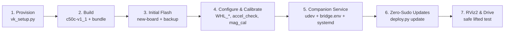

# First hardware deployment

This guide walks end-to-end through bringing up a **C50C V1.1** board, an **Ubuntu 24.04 companion computer** (such as a Raspberry Pi 5), and an **Ubuntu 24.04 desktop machine** from bare machines to live RViz2 telemetry and a first safe drive check. Each stage gives the essential commands and links to the dedicated reference guide for deeper options.



> [!NOTE]
> Keep `tools/setup/vk_setup.py` handy on every machine. Running it with `--check` is the fastest way to verify prerequisites after any step ([Environment setup](setup.md)).

## Stage 1: Provision machines

Clone the repository with submodules on your **development host** (Ubuntu 24.04, `amd64` or `arm64`), and run `vk_setup.py` for each machine's role ([Environment setup](setup.md)):

1. **Development host** (builds firmware, SITL, tests, and flashes locally):
   ```bash
   git clone --recurse-submodules https://github.com/chimu0510/VehKernel.git
   cd VehKernel
   tools/setup/vk_setup.py --role dev --role flash --dry-run
   tools/setup/vk_setup.py --role dev --role flash
   ```
   Log out and log back in so `docker`, `dialout`, and `plugdev` group memberships take effect, then verify:
   ```bash
   tools/setup/vk_setup.py --role dev --role flash --check
   ```

2. **Companion computer** (Ubuntu 24.04, e.g. Raspberry Pi 5):
   Ensure `openssh-server` is running and SSH key authentication works from the development host (`~/.ssh/config`). Clone the repository into a colcon workspace (submodules are not required for the Bridge), install ROS2 Jazzy + serial permissions, build `vehkernel_bridge`, and install the user `systemd` service:
   ```bash
   mkdir -p ~/vk_ws/src
   git clone https://github.com/chimu0510/VehKernel.git ~/vk_ws/src/VehKernel
   ~/vk_ws/src/VehKernel/tools/setup/vk_setup.py --role companion --yes \
       --workspace ~/vk_ws --build-bridge --install-bridge-service
   ```
   Log out and log back in for `dialout`, then verify:
   ```bash
   ~/vk_ws/src/VehKernel/tools/setup/vk_setup.py --role companion \
       --workspace ~/vk_ws --build-bridge --install-bridge-service --check
   ```

3. **Desktop machine** (Ubuntu 24.04 running RViz2 and teleoperation; can be the same machine as the development host):
   ```bash
   tools/setup/vk_setup.py --role desktop --yes
   tools/setup/vk_setup.py --role desktop --check
   ```

4. **Synchronize clocks** between the companion computer and desktop machine before running ROS2 across the network ([Clock synchronization](companion-computer.md#clock-synchronization)):
   ```bash
   tools/setup/ntp_offset.py pool.ntp.org
   ssh user@companion python3 - pool.ntp.org < tools/setup/ntp_offset.py
   ```
   Both machines should agree within a few milliseconds.

## Stage 2: Build C50C firmware and Host Tools Bundle

On the **development host**, configure and build the C50C V1.1 firmware and its architecture-independent **Host Tools Bundle** inside the development container (`vk`) ([Building](building.md)):

```bash
vk cmake --preset c50c-v1_1
vk cmake --build --preset c50c-v1_1 --target bundle
```

This writes the firmware images under `build/c50c-v1_1/app/` (`vehkernel.apj`, `vehkernel_with_bl.hex`, `vehkernel.elf`) and packages the self-contained archive `build/c50c-v1_1/vehkernel-c50c-v1_1-<commit>.tar.gz`.

## Stage 3: Initial board flash and vendor backup

A fresh C50C V1.1 (or one still running vendor firmware) must be flashed once over **`SERIAL2` (the one-key download port)** using `new-board`, which backs up the full chip, erases Flash, and writes both the Vehkernel bootloader (`S0`) and firmware (`S4`–`S7`) ([Flashing](flashing.md#a-new-board-new-board), [C50C V1.1](../boards/c50c-v1_1.md#serial-ports)).

> [!WARNING]
> **Always pass an explicit `--backup` path outside both the repository root and the unpacked bundle directory.** Saving a dump inside the repository root breaks `reuse_lint`, and saving inside the bundle directory risks losing the backup when `deploy.py` replaces that directory on the next deploy. For remote `deploy.py`, avoid `~/` (an unquoted `~/` expands to the development host's home directory, and `flash_serial.py` does not expand a literal `~`); use `../c50c_v1_1_flash.bin` (writes to `~/vehkernel/c50c_v1_1_flash.bin` on the companion computer, outside the bundle directory) or an explicit remote path such as `/home/<user>/c50c_v1_1_flash.bin`.

Run on the **host** (outside `vk`), either directly wired to the development host or over SSH to the companion computer:

```bash
# Option A: C50C SERIAL2 plugged directly into the development host
tools/flash/flash_serial.py --port /dev/ttyACM0 new-board --backup ~/c50c_v1_1_flash.bin

# Option B: C50C SERIAL2 wired to the companion computer
# ../c50c_v1_1_flash.bin writes to ~/vehkernel/c50c_v1_1_flash.bin (outside the bundle dir)
tools/flash/deploy.py user@companion --port /dev/ttyACM0 new-board --backup ../c50c_v1_1_flash.bin
```

`new-board` takes about 2 minutes at 115200 baud. After it finishes, confirm the Link is live over `SERIAL1` or `SERIAL2` ([Link monitor](link-monitor.md#checks)):

```bash
tools/link/link_monitor.py --serial /dev/ttyACM0 \
    --msg-dir build/c50c-v1_1/generated/schema/python \
    --check --duration 5 --expect-rate imu_sample:0=200
```

*(Omit `--msg-dir` and `--param-meta` when running from inside an unpacked Host Tools Bundle on the companion computer.)*

## Stage 4: Configure vehicle geometry and sensor calibration

With the vehicle **disarmed** and drive power off, set your frame parameters and verify sensor alignment ([Driving the wheels](driving.md#vehicle-description), [Estimation](estimation.md)):

1. **Set vehicle geometry and wheel mapping** (example for a 2-wheel differential chassis; adjust `FRAME_TYPE`, `WHL_RADIUS`, `WHL_TRACK`, and `WHL_*_OUT` for your vehicle):
   ```bash
   tools/link/link_monitor.py --serial /dev/ttyACM0 \
       --msg-dir build/c50c-v1_1/generated/schema/python \
       --param-meta build/c50c-v1_1/generated/params/params.json \
       param set FRAME_TYPE DIFF_2WD
   # Repeat param set for WHL_RADIUS, WHL_TRACK, WHL_LEFT_OUT, WHL_RIGHT_OUT
   ```
   Reboot so `reboot_required` geometry parameters take effect:
   ```bash
   tools/link/link_monitor.py --serial /dev/ttyACM0 \
       --msg-dir build/c50c-v1_1/generated/schema/python reboot
   ```

2. **Prepare a git-ignored directory for ULog recordings** so stray `.ulg` files never pollute the repository root or fail `reuse_lint`:
   ```bash
   mkdir -p vendor
   ```

3. **Verify board orientation (`SENS_BOARD_ROT`) with `accel_check.py`** ([Checking board orientation](estimation.md#checking-board-orientation-accel_checkpy)):
   Record two 12 s stationary logs (one level, one tilted nose-down by at least 40°), then check:
   ```bash
   tools/link/link_monitor.py --serial /dev/ttyACM0 \
       --msg-dir build/c50c-v1_1/generated/schema/python \
       record vendor/level.ulg --profile estimator_replay --duration 12
   tools/link/link_monitor.py --serial /dev/ttyACM0 \
       --msg-dir build/c50c-v1_1/generated/schema/python \
       record vendor/nose_down.ulg --profile estimator_replay --duration 12
   tools/log/accel_check.py vendor/level.ulg vendor/nose_down.ulg
   ```
   If `accel_check.py` recommends a different `SENS_BOARD_ROT`, apply it and `reboot` before continuing.

4. **Calibrate the magnetometer with `mag_cal.py`** (if using heading fusion or inspecting magnetic heading; [Magnetometer calibration](estimation.md#magnetometer-calibration)):
   Record with `estimator_replay`, keep still for 1.5 s, rotate slowly in place for at least two full revolutions (720°), stop for 1 s, press `Ctrl-C`, and fit + apply:
   ```bash
   tools/link/link_monitor.py --serial /dev/ttyACM0 \
       --msg-dir build/c50c-v1_1/generated/schema/python \
       record vendor/mag_cal.ulg --profile estimator_replay
   tools/log/mag_cal.py vendor/mag_cal.ulg --apply --serial /dev/ttyACM0 \
       --msg-dir build/c50c-v1_1/generated/schema/python
   ```

## Stage 5: Enable the Companion ROS2 Bridge service

On the **companion computer**, avoid unstable `/dev/ttyACM*` numbering—especially when both C50C V1.1 CH9102F ports (`SERIAL1` and `SERIAL2`) are connected, because both adapters share the same `/dev/serial/by-id/` entry ([C50C V1.1 serial ports](../boards/c50c-v1_1.md#serial-ports)):

1. **Pin serial devices by physical USB port:** Inspect `ls -l /dev/serial/by-path/` (and confirm which port is `mcu_link instance=0` vs `instance=1` with `link_monitor.py --check`), then uncomment and fill the `ENV{ID_PATH}` or `KERNELS` rules for `/dev/vehkernel-link` and `/dev/vehkernel-download` in `/etc/udev/rules.d/99-vehkernel.rules` and reload udev:
   ```bash
   sudo udevadm control --reload-rules && sudo udevadm trigger
   ```

2. **Configure `~/.config/vehkernel/bridge.env`:** Set the absolute workspace path (do not use `~`), pinned serial device, baud rate, and a `ROS_DOMAIN_ID` that matches your desktop machine ([Running the Bridge as a user service](ros2-bridge.md#running-the-bridge-as-a-user-service)):
   ```bash
   cat ~/.config/vehkernel/bridge.env
   # Ensure:
   # VK_BRIDGE_WORKSPACE=/home/<user>/vk_ws
   # VK_BRIDGE_DEVICE=/dev/vehkernel-link
   # VK_BRIDGE_BAUD=921600
   # ROS_DOMAIN_ID=0
   ```

3. **Start and verify the user `systemd` service:**
   ```bash
   systemctl --user enable --now vehkernel-bridge.service
   systemctl --user status vehkernel-bridge.service
   journalctl --user -u vehkernel-bridge.service -n 30
   ```
   The log should report `handshake done`, `no topic's schema hash differs`, and `time synchronization`.

## Stage 6: Ongoing zero-sudo firmware updates

Once the Vehkernel bootloader and `vehkernel-bridge.service` are in place, deploy every subsequent firmware build from the **development host** in one command—without `sudo` and while preserving stored parameters ([Flashing](flashing.md#from-the-development-host-in-one-command)):

```bash
tools/flash/deploy.py --archive build/c50c-v1_1/vehkernel-c50c-v1_1-<commit>.tar.gz \
    user@companion --port /dev/vehkernel-download update
```

*(Pass `--preset c50c-v1_1` or omit `--archive` to deploy the newest archive in `build/c50c-v1_1/` automatically.)*

`deploy.py` copies the archive over SSH, unpacks it under `~/vehkernel/`, stops the active `vehkernel-bridge.service` user unit, flashes `app/vehkernel.apj` via `uploader.py`, verifies the booted git commit over the Link, and restarts `vehkernel-bridge.service`—even if flashing fails.

## Stage 7: Desktop visualization and first safe drive check

On the **desktop machine** (with matching `ROS_DOMAIN_ID` and `ufw` allowing UDP `7400:7500` if active):

1. **Confirm ROS2 discovery and open RViz2** ([Viewing in RViz](ros2-bridge.md#viewing-in-rviz)):
   ```bash
   echo ${ROS_DOMAIN_ID:-0}
   ros2 topic list
   rviz2 -d bridge/vehkernel_bridge/rviz/bridge.rviz
   ```
   Tilt and yaw the vehicle by hand and verify that `base_link`'s axes follow the motion smoothly (red forward, green left, blue up).

2. **Run a lifted safe drive check:**

> [!WARNING]
> **Lift all wheels completely off the ground before arming for the first time.** Confirm `MOT_OUT_MAX` is kept low (the default `0.3` caps output at 30 % duty) and keep a physical power cutoff or Emergency Stop ready. Verify motor-to-encoder direction with `bringup motors` first ([Motor bring-up](driving.md#motor-bring-up)).

   Switch to `COMPANION` mode, arm, send a gentle forward velocity setpoint, and disarm ([Driving](ros2-bridge.md#driving)):
   ```bash
   ros2 service call /vehkernel/set_mode vehkernel_msgs/srv/SetMode "{mode_name: COMPANION}"
   ros2 service call /vehkernel/arm std_srvs/srv/SetBool "{data: true}"
   ros2 topic pub -r 10 --times 20 /cmd_vel geometry_msgs/msg/TwistStamped "{twist: {linear: {x: 0.2}}}"
   ros2 service call /vehkernel/arm std_srvs/srv/SetBool "{data: false}"
   ```
   Verify every wheel spins in the forward direction and `/odom` advances along `base_link` +x. If a mirrored wheel spins backward, disarm and flip both `MOTn_REV` and `MOTn_ENC_REV` ([Vehicle description](driving.md#vehicle-description)).

## Next steps

- [Driving the wheels](driving.md) — motor bring-up, yaw-rate tuning, USB gamepad takeover in `MANUAL`, and fault-stop checks.
- [ROS2 Bridge](ros2-bridge.md) — launch arguments, `teleop_twist_keyboard` (`cmd_vel_stamped:=false`), and Nav2 integration.
- [Troubleshooting](troubleshooting.md) — symptom-to-fix index when a check fails.
